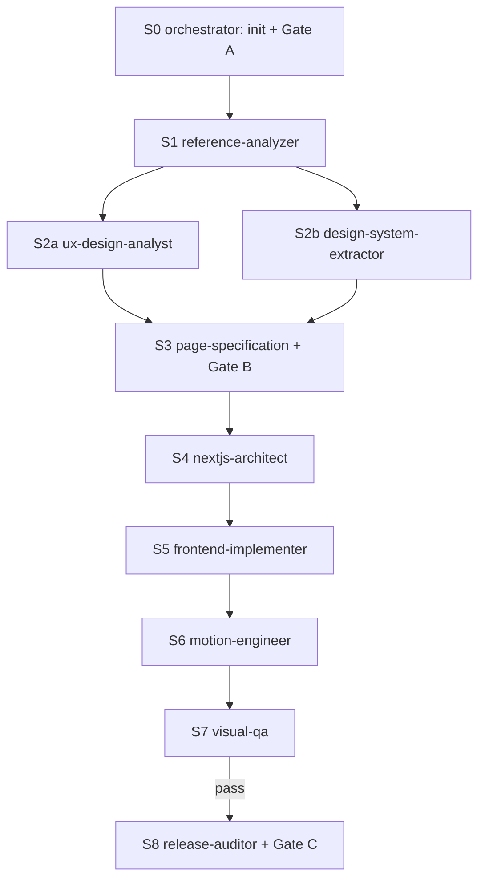

# VisualForge — Dependency Graph

Status: **Approved** (2026-11-14)

## 1. Stage graph (forward edges only — a DAG)



## 2. Artifact-level dependencies

| Consumer | Reads (producer) |
|---|---|
| S1 reference-analyzer | `brief.md` (S0) |
| S2a ux-design-analyst | `research/*` (S1), `brief.md` |
| S2b design-system-extractor | `research/*` (S1), `brief.md` |
| S3 page-specification | `analysis/ux-findings.json` (S2a), `design/tokens.json`, `design/design-system.md` (S2b), `brief.md` |
| S4 nextjs-architect | `specs/*` (S3), `design/tokens.json` (S2b) |
| S5 frontend-implementer | `architecture/*`, `site/` (S4), `specs/pages`, `specs/content` (S3), `design/tokens.json` (S2b) |
| S6 motion-engineer | `specs/motion-spec.json` (S3), `design/tokens.json` (S2b), `site/` (S5) |
| S7 visual-qa | `site/` (S6), `specs/*` (S3), `design/tokens.json` (S2b), `analysis/ux-findings.json` (S2a), `research/pages/*` screenshots (S1), previous `qa/iteration-*` |
| S8 release-auditor | `site/`, `qa/summary.json` (S7), `specs/*`, `design/*`, `research/assets-inventory.json` + reference text (S1), `brief.md` |

Transitive edges (e.g. S4 reading tokens directly from S2b) are allowed
because S2b → S3 → S4 already orders them. They matter for
**invalidation**: a change to `tokens.json` makes S3, S4, S5, S6, S7, S8
stale through the fingerprint mechanism, not only via S3.

## 3. Feedback edges (not dependencies)

```
S7 ──defects──► S2b | S3 | S4 | S5 | S6   (fix mode)
S8 ──defects──► S2b | S3 | S4 | S5 | S6   (fix mode)
S2a/S2b ──recapture_requests──► S1        (targeted re-capture)
Gate B/C rejection ──feedback──► owning stage (fix mode)
```

These are **bounded, orchestrator-mediated loops**, not cyclic
dependencies:

- A feedback edge never makes a stage wait on a downstream stage's
  output in order to *start*. It produces a new **revision** of an
  upstream artifact, after which downstream stages become `stale` and
  re-run in forward order.
- Each loop has a budget (QA: 3 iterations; re-capture: 1 round per
  analysis stage; gate rejection: user-driven).
- Upstream analysis (S1, S2a) is never invalidated by build-phase defects.

Graph acyclicity is therefore checked on forward edges only, and the
orchestrator refuses to register any new forward edge that would create a
cycle.

## 4. Parallel vs. sequential

| Set | Mode |
|---|---|
| {S2a, S2b} | Parallel (subagents) |
| All other stage pairs | Sequential |
| Within S1 | Sequential (single MCP browser) |
| Within S5 | Sequential by default; optional opt-in worktree parallelism by page after primitives |
| Within S7, S8 | Parallel test workers / shell commands, one skill run |

Critical path: S0 → S1 → max(S2a, S2b) → S3 → S4 → S5 → S6 → S7(×n) → S8.

## 5. Architecture review

### 5.1 Missing dependencies — checked and resolved

| Finding | Resolution |
|---|---|
| visual-qa needs reference screenshots to judge principle alignment, not only specs. | Added S1 → S7 artifact edge. |
| visual-qa needs UX principles to judge hierarchy/rhythm. | Added S2a → S7 artifact edge. |
| release-auditor needs reference text + asset inventory for the originality audit. | Added S1 → S8 artifact edge; S1 stores visible text per page. |
| motion-engineer needs motion *values*, not just intent. | Motion tokens owned by S2b; S2b → S6 edge. |
| nextjs-architect needs the viewport set to configure Playwright projects. | Viewport set lives in `brief.md`/state config, available to all stages. |
| Original brand identity had no owner. | Visual identity → S2b; copy & asset briefs → S3. |
| Shared data contracts had no home. | `schemas/` at repo root (data contracts only). |
| Accessibility scanner not in permanent stack. | `@axe-core/playwright` approved as a stack addition; graceful `not_run` fallback if unavailable. |

### 5.2 Circular dependencies — none in forward graph

Candidates examined:

- **QA ↔ build**: modelled as feedback revisions (§3), not dependencies.
- **design-system ↔ page-spec**: spec may reveal a missing token. Spec
  records it as an open question / defect owned by S2b; S2b revises in
  fix mode; S3 becomes stale. No mutual waiting.
- **architect ↔ implementer**: implementer may need a new primitive.
  It may add components (its domain) but not config/token pipeline; a
  needed config change is a defect for S4.
- **analysis ↔ research**: analysts request re-captures; S1 runs a
  targeted pass and analysts re-run. Bounded to one round.

### 5.3 Overlapping responsibilities — resolved

| Overlap | Owner decided |
|---|---|
| Who browses the reference? | Only reference-analyzer. |
| Who analyses motion? | Facts: S1. Character: S2a. Values: S2b. Intent per section: S3. Code: S6. |
| Who defines responsive behaviour? | Observed breakpoints: S1. Responsive strategy: S2a. Breakpoint tokens: S2b. Per-section layout per viewport: S3. Implementation: S5. |
| Who checks accessibility? | Build-time correctness: S5/S6. Detection: S7. Final verification: S8. S7 and S8 overlap deliberately — S8 is the independent re-measurement and must not reuse S7's results as its own. |
| Who creates Playwright tests? | Harness/config: S4. Section self-checks: S5 (optional, local). QA and visual-regression suites: S7. S8 runs existing suites only. |
| Who writes copy? | S3 only. S5 must not invent copy; gaps are defects for S3. |
| Who chooses fonts? | S2b (with licence). S4 wires them via `next/font`. |

### 5.4 Agent count review

Ten skills, one orchestrator in the main session, two subagents for the
S2 pair. No standing custom agents in `.claude/agents/` are required.
Merging candidates considered and rejected:

- *ux-design-analyst + design-system-extractor*: different outputs and
  evaluation criteria (qualitative vs. quantitative); keeping them apart
  enables the only stage-level parallelism.
- *visual-qa + release-auditor*: QA iterates with the builders; the
  auditor is a one-shot, independent gate. Merging would weaken the
  independence of the final check.
- *frontend-implementer + motion-engineer*: separating them keeps static,
  accessible output stable before motion is layered on, and keeps motion
  isolated in small Client Components.
